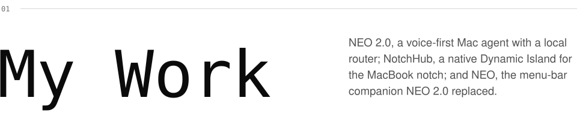

<!--
  Every visual here is an SVG built by scripts/build_assets.py, in the design
  language of arnavparashar.com, with a light and a dark version that follow
  the viewer's GitHub theme. Edit the script and rerun it; don't hand-edit the SVGs.
-->

<a href="https://arnavparashar.com">
  <picture>
    <source media="(prefers-color-scheme: dark)" srcset="https://raw.githubusercontent.com/ArnavParashar49/ArnavParashar49/main/assets/dark/hero.svg">
    
  </picture>
</a>

  

<picture>
  <source media="(prefers-color-scheme: dark)" srcset="https://raw.githubusercontent.com/ArnavParashar49/ArnavParashar49/main/assets/dark/section-work.svg">
  
</picture>

<a href="https://github.com/ArnavParashar49/Neo2.0">
  <picture>
    <source media="(prefers-color-scheme: dark)" srcset="https://raw.githubusercontent.com/ArnavParashar49/ArnavParashar49/main/assets/dark/card-neo.svg">
    
  </picture>
</a>

<a href="https://github.com/ArnavParashar49/NotchHub">
  <picture>
    <source media="(prefers-color-scheme: dark)" srcset="https://raw.githubusercontent.com/ArnavParashar49/ArnavParashar49/main/assets/dark/card-notchhub.svg">
    
  </picture>
</a>

  And before both of those: <a href="https://github.com/ArnavParashar49/NEO"><b>NEO</b></a>, a real-time, voice-first companion that lives in your menu bar. It hears, sees, remembers and controls your computer locally.

 

<picture>
  <source media="(prefers-color-scheme: dark)" srcset="https://raw.githubusercontent.com/ArnavParashar49/ArnavParashar49/main/assets/dark/stack.svg">
  
</picture>

  

<picture>
  <source media="(prefers-color-scheme: dark)" srcset="https://raw.githubusercontent.com/ArnavParashar49/ArnavParashar49/output/github-snake-dark.svg">
  
</picture>

  
LIVE STATS

   
  

 

<a href="https://arnavparashar.com">
  <picture>
    <source media="(prefers-color-scheme: dark)" srcset="https://raw.githubusercontent.com/ArnavParashar49/ArnavParashar49/main/assets/dark/footer.svg">
    
  </picture>
</a>
